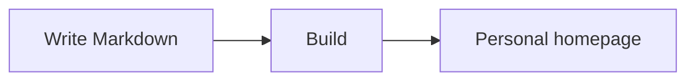

# Personal Homepage

VitePress personal site with English at / and Simplified Chinese at /zh-cn/.
Each language has About/, Projects/, and Blogs/ directories with title-only placeholders.
The two existing homepage index.md files are preserved. Their old internal documentation
buttons are mapped to About and Projects during the build.

## Local development and deployment

- pnpm install --frozen-lockfile
- pnpm docs:dev
- pnpm docs:build
- pnpm docs:preview

GitHub Pages builds use pnpm and publish docs/.vitepress/dist.
The inherited Office Tool custom domain has been removed.

## Writing

Add Markdown under docs/About, docs/Projects, docs/Blogs and the corresponding
folders inside docs/zh-cn. Inline formulas use $E = mc^2$.
Display formulas use a line containing $$, then the equation, then another $$ line.
Diagrams use fenced code blocks with the language mermaid, for example:

MathJax renders formulas to inline SVG during the build (no browser math script).
Mermaid and its lazy-loaded diagram chunks are bundled into this site's assets.
VitePress fonts, search, styles and scripts are hosted locally. Analytics is removed,
and the content security policy blocks external runtime resources.
External homepage links remain as requested; they load only when clicked.
Installing dependencies still requires a package registry.
