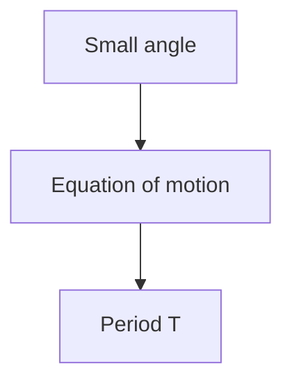

# Course notes demo

This is a sample course note, not a record of a real course. It uses a simple pendulum to show one way to organize the page.

## Course information

- Course: Mechanics (sample)
- Term: Fall 2025 (sample)
- Instructor or source: textbook, chapter 2 (sample)

## Example: the small-angle pendulum

A simple pendulum of length $L$ swings under gravity. At small angles, its motion obeys

$$
\ddot{\theta} + \frac{g}{L}\theta = 0,
$$

where $\theta$ is the angle between the string and the vertical. The period is then

$$
T = 2\pi\sqrt{\frac{L}{g}}.
$$

The path from the approximation to the result is short:

## Key concepts

- Small-angle approximation — replace $\sin\theta$ with $\theta$, which makes the equation linear.
- Period — the time for one complete swing, $T$ in the formula above.

## Questions to revisit

- What changes when the angle is no longer small?

## References

- Textbook chapter on oscillations (sample reference).
