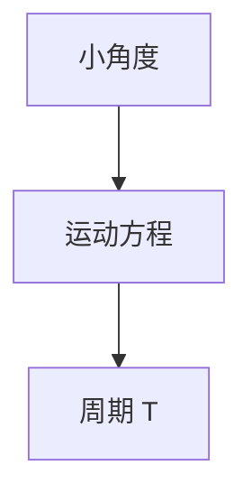

# 课程笔记演示

这是一篇示例课程笔记，不对应真实课程。页面用小角度单摆为例，展示课程笔记可以怎样组织。

## 课程信息

- 课程：力学（示例）
- 学期：2025 年秋季（示例）
- 教师或资料来源：教材第 2 章（示例）

## 示例：小角度单摆

长度为 $L$ 的单摆在重力作用下摆动。角度很小时，运动满足

$$
\ddot{\theta} + \frac{g}{L}\theta = 0,
$$

其中 $\theta$ 是摆角，即摆绳与竖直方向的夹角。此时周期为

$$
T = 2\pi\sqrt{\frac{L}{g}}.
$$

从近似到结论的过程很短：

## 关键概念

- 小角度近似 — 用 $\theta$ 代替 $\sin\theta$，方程变为线性方程。
- 周期 — 完成一次完整摆动所需的时间，即上式中的 $T$。

## 待复习问题

- 角度不再很小时，会发生什么变化？

## 参考资料

- 教材中关于振动的章节（示例参考）。
