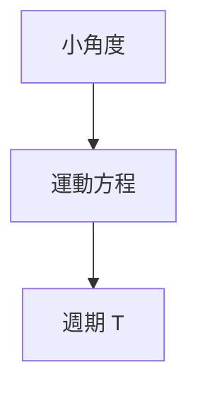

# 課程筆記示範

這是一篇示範課程筆記，不對應真實課程。頁面用小角度單擺為例，展示課程筆記可以怎樣組織。

## 課程資訊

- 課程：力學（示範）
- 學期：2025 年秋季（示範）
- 教師或資料來源：教材第 2 章（示範）

## 示範：小角度單擺

長度為 $L$ 的單擺在重力作用下擺動。角度很小時，運動滿足

$$
\ddot{\theta} + \frac{g}{L}\theta = 0,
$$

其中 $\theta$ 是擺角，即擺繩與豎直方向的夾角。此時週期為

$$
T = 2\pi\sqrt{\frac{L}{g}}.
$$

從近似到結論的過程很短：

## 關鍵概念

- 小角度近似 — 用 $\theta$ 代替 $\sin\theta$，方程變為線性方程。
- 週期 — 完成一次完整擺動所需的時間，即上式中的 $T$。

## 待複習問題

- 角度不再很小時，會發生什麼變化？

## 參考資料

- 教材中關於振動的章節（示範參考）。
